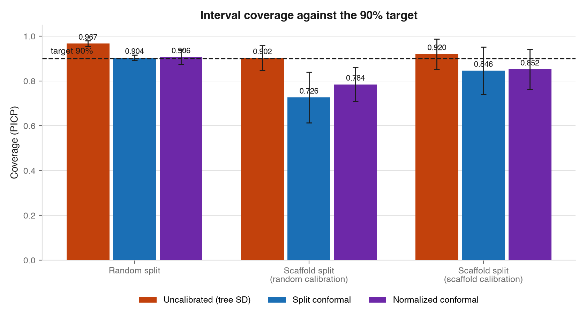
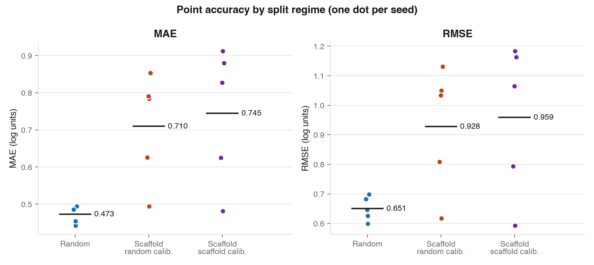
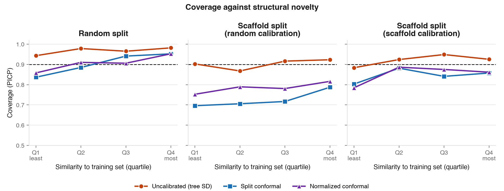
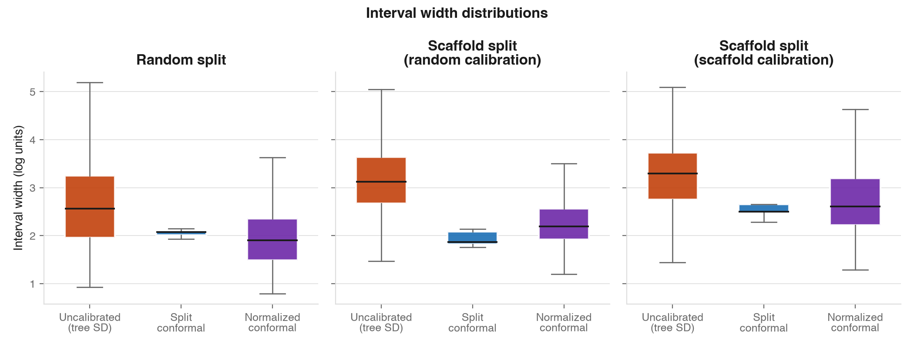

# Reliable AI for Drug Candidate Screening — conformal LogS prediction

Implementation of the DS 340W project described in the midterm presentation:
a reproducible evaluation of **conformal prediction** for molecular property
prediction, using a Random Forest on RDKit descriptors to predict aqueous
solubility (LogS) and asking whether its 90% prediction intervals can be
trusted — especially for molecules unlike anything in the training set.

The rest of this repository is the forked [V-SYNTHES2](../README.md) virtual
screening pipeline (parent paper 1), which motivates the problem: screening at
scale only pays off if the predictions it produces can be trusted.

---

## Quickstart

```bash
python3 -m venv .venv && source .venv/bin/activate
pip install -r conformal_logS/requirements.txt
```

```bash
mkdir -p conformal_logS/data/raw && curl -sfL -o conformal_logS/data/raw/delaney-processed.csv https://deepchemdata.s3-us-west-1.amazonaws.com/datasets/delaney-processed.csv
```

```bash
cd conformal_logS && python scripts/run_experiment.py
```

The full sweep (3 split regimes × 3 interval methods × 5 seeds) takes about
two minutes on a laptop. `--quick` runs one seed with 100 trees. Tables land
in `results/`, figures in `results/figures/`, and the H1–H3 verdicts are
printed as a markdown table.

```bash
cd conformal_logS && python -m pytest tests -q
```

> **RDKit must be older than 2026.03.** Release 2026.09 ships a broken Murcko
> decomposition (`bad any cast`) that makes every scaffold split fail;
> `requirements.txt` pins below it, and `splits.py` raises a readable error if
> you end up on a bad version anyway.

---

## What the pipeline does

```
SMILES + measured LogS          1,117 molecules after curation
        │
        ├─ RDKit descriptors (216)  ─────────►  Random Forest (500 trees)
        │                                               │
        └─ Morgan fingerprints  ──► Tanimoto            │
           (novelty analysis)                           ▼
                                           calibration set → 90% interval
                                                            │
                                                            ▼
                                        MAE · RMSE · PICP · MPIW · coverage gap
```

**Data.** The Delaney (ESOL) set, 1,128 rows. Curation canonicalizes every
SMILES, drops unparseable rows, and collapses duplicate structures to the
median of their measurements (11 collapsed here, leaving 1,117). Without that
last step a molecule could appear on both sides of a split and quietly inflate
coverage.

**Features.** All RDKit descriptors except `Ipc`, which overflows on
medium-sized rings. Non-finite values become NaN and are imputed with the
*training* median inside the sklearn pipeline, so nothing leaks from the test
set into the model.

**Three split regimes**, which is the heart of the experiment:

| Regime | Test set | Calibration set |
|---|---|---|
| `random` | random molecules | random molecules |
| `scaffold` | scaffold-disjoint | **random** slice of the remaining data |
| `scaffold_ood_calib` | scaffold-disjoint | **its own** scaffold block |

The third regime is an addition to the proposal, and it earns its place: under
`scaffold`, the calibration data is exchangeable with the *training* data but
not with the *test* data, so conformal prediction's guarantee does not apply.
Comparing the two scaffold regimes separates "the model is worse out of
distribution" from "the calibration set came from the wrong distribution" —
two explanations for the same lost coverage, with very different fixes.

**Three interval methods**, all wrapped around the same fitted forest, so any
difference in coverage comes from calibration alone:

- `uncalibrated_gaussian` — ±1.645 × (standard deviation across trees). The
  common practice the project argues against: it assumes Gaussian errors and a
  calibrated ensemble spread, and guarantees nothing.
- `split_conformal` — one width for every molecule, set to the
  ⌈(n+1)(1−α)⌉-th smallest absolute residual on a held-out calibration set.
  The finite-sample rank is taken directly on the sorted scores, not through
  `np.quantile`, whose interpolation would erode the guarantee.
- `normalized_conformal` — the same guarantee, but the non-conformity score is
  divided by a per-molecule difficulty estimate (the tree spread), so hard
  molecules get wider intervals than easy ones.

**Structural novelty (H3).** For each test molecule, the maximum Tanimoto
similarity to any *training* molecule, on Morgan fingerprints. Maximum, not
mean: what matters is whether the model has seen anything like this compound.
Test molecules are then grouped into equal-count quartiles, Q1 being least
familiar.

---

## Results

Mean over 5 seeds, 90% target intervals. Full tables in `results/`.

| Split | Method | MAE | RMSE | PICP | MPIW | Coverage gap | Interval score |
|:---|:---|---:|---:|---:|---:|---:|---:|
| random | uncalibrated | 0.473 | 0.651 | 0.967 | 2.692 | +0.067 | 2.946 |
| random | **split conformal** | 0.473 | 0.651 | **0.904** | 2.053 | **+0.004** | 2.987 |
| random | **normalized conformal** | 0.473 | 0.651 | **0.906** | 1.986 | **+0.006** | **2.694** |
| scaffold | uncalibrated | 0.710 | 0.928 | 0.902 | 3.209 | +0.002 | 4.238 |
| scaffold | split conformal | 0.710 | 0.928 | 0.726 | 1.933 | −0.174 | 5.076 |
| scaffold | normalized conformal | 0.710 | 0.928 | 0.784 | 2.240 | −0.116 | 4.545 |
| scaffold (OOD calib.) | uncalibrated | 0.745 | 0.959 | 0.920 | 3.304 | +0.020 | 4.300 |
| scaffold (OOD calib.) | split conformal | 0.745 | 0.959 | 0.846 | 2.627 | −0.054 | 4.494 |
| scaffold (OOD calib.) | normalized conformal | 0.745 | 0.959 | 0.852 | 2.694 | −0.048 | 4.298 |



### H1 — conformal calibration beats the uncalibrated baseline

**Supported under random splitting; not supported under scaffold splitting.**

On random splits the result is clean: both conformal variants land on 0.904
and 0.906 against a 0.900 target, while the uncalibrated baseline over-covers
at 0.967 — and it buys that coverage with intervals 31% wider (2.69 vs 2.05
log units). Normalized conformal is the best method overall here: the same
coverage as split conformal with the narrowest intervals and the best interval
score.

Under scaffold splitting the picture reverses, and the honest reading is that
H1 fails. Split conformal drops to 0.726 coverage. The uncalibrated baseline
*appears* to win at 0.902 — but it is not calibrated, it is simply wide
(MPIW 3.21), and it stays wide whether or not that width is needed. The
interval score, which penalizes width and misses together, rates the baseline
better than split conformal under scaffold shift (4.24 vs 5.08).

This is not a bug in the conformal implementation; it is the assumption
failing. Split conformal guarantees coverage when the calibration and test
data are exchangeable. A scaffold split is designed to break exactly that.

### H1\* — calibrating on unfamiliar molecules recovers most of the loss

This is the finding the third split regime was added to produce. Keeping the
test set fixed and changing only where the calibration molecules come from:

| Method | Random calibration | Scaffold calibration |
|:---|---:|---:|
| split conformal | 0.726 (gap −0.174) | **0.846** (gap −0.054) |
| normalized conformal | 0.784 (gap −0.116) | **0.852** (gap −0.048) |

Two-thirds of the lost coverage comes back. The practical lesson for a
screening campaign is concrete: **calibrate on molecules as unfamiliar as the
ones you intend to predict**, not on a convenient random slice of the training
library. The remaining ~5-point shortfall is the part that structural shift
genuinely costs you.

### H2 — scaffold splitting costs accuracy

**Supported.** RMSE rises from 0.651 (random) to 0.928 (scaffold), and MAE
from 0.473 to 0.710 — roughly a 45% increase in error on both measures,
consistent across all five seeds.



### H3 — reliability degrades for structurally unfamiliar molecules

**Supported, in every split regime and for every method** (9 of 9
comparisons: 3 splits × 3 methods). Coverage falls as test molecules get less
similar to the training set:

| Split | Method | Q1 (least familiar) | Q4 (most familiar) |
|:---|:---|---:|---:|
| random | split conformal | 0.837 | 0.952 |
| random | normalized conformal | 0.858 | 0.952 |
| scaffold | split conformal | 0.696 | 0.787 |
| scaffold | normalized conformal | 0.753 | 0.816 |



Note what this means even in the friendly case: on a *random* split, where
marginal coverage is a near-perfect 0.904, the least familiar quartile is only
covered 0.837 of the time. Marginal validity is an average over the whole test
set, and it hides exactly the molecules a screening campaign cares most about.
Normalizing by tree spread helps — it widens intervals where the forest
disagrees — but it does not close the gap.



### Summary

- Conformal prediction delivers what it promises **when its assumption holds**,
  and does so with tighter intervals than an uncalibrated ensemble.
- A scaffold split breaks that assumption, and coverage falls to ~0.73.
- Most of that loss is a *calibration-set* problem, not a model problem:
  matching the calibration distribution to the deployment distribution
  recovers it to ~0.85.
- Marginal coverage is not conditional coverage. Reliability is consistently
  worst for the unfamiliar molecules, which is where a screening campaign
  needs it most.

---

## Repository layout

```
conformal_logS/
├── README.md
├── requirements.txt
├── data/
│   ├── raw/delaney-processed.csv      downloaded once, not modified
│   └── processed/esol_curated.csv     written by the pipeline
├── results/                           tables, figures, config + environment record
├── scripts/run_experiment.py          CLI entry point
├── src/conformal_solubility/
│   ├── config.py        every tunable in one dataclass, saved with the results
│   ├── data.py          load, canonicalize, de-duplicate
│   ├── features.py      RDKit descriptors + Morgan fingerprints
│   ├── splits.py        random / scaffold / scaffold-OOD-calibration splits
│   ├── conformal.py     the forest and the three interval methods
│   ├── metrics.py       MAE, RMSE, PICP, MPIW, coverage gap, interval score
│   ├── novelty.py       Tanimoto novelty and per-quartile reliability
│   ├── experiment.py    the sweep, aggregation, and H1–H3 verdicts
│   └── plots.py         the four figures
└── tests/               40 tests: coverage guarantee, split disjointness, metrics
```

## Reproducibility

Every run writes `results/config.json` (all settings), `results/environment.json`
(package versions), and `results/curation_counts.json` (what curation dropped),
alongside the per-seed metrics. Splits and forests are seeded; re-running the
command reproduces the numbers above.

The test suite checks the parts that would fail silently: that split conformal
achieves nominal coverage on synthetic data, that the finite-sample quantile
uses the right rank, that no scaffold leaks across a split, and that the
metrics match hand-computed values.

## Limitations and next steps

- **One dataset, one property.** ESOL is small (1,117 molecules) and
  well-curated. The scaffold-split numbers carry wide seed-to-seed spread
  (PICP std up to 0.11) because the test set is a handful of scaffold groups.
  AqSolDB (~9,900 compounds) would tighten this.
- **Descriptors, not a learned representation.** The parent paper uses a graph
  neural network; the RMSE here (0.65 random / 0.93 scaffold) is in the
  expected range for a descriptor-based Random Forest but is not competitive
  with a GNN.
- **Marginal, not conditional, conformal methods.** Mondrian (group-conditional)
  conformal prediction, binned on the same Tanimoto novelty used in the H3
  analysis, is the natural next step: it would target coverage *within* each
  novelty bin instead of on average.
- **Difficulty estimate.** Tree spread is a convenient proxy but understates
  the irreducible noise term. A quantile-regression forest, or a separate model
  of the residual magnitude, would likely sharpen the normalized variant.
