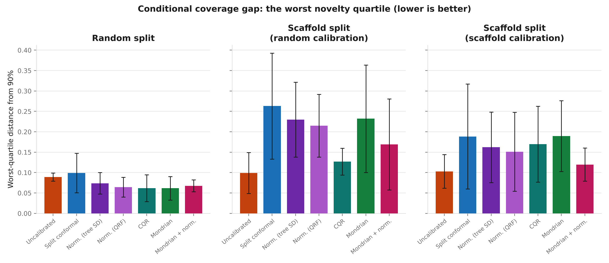
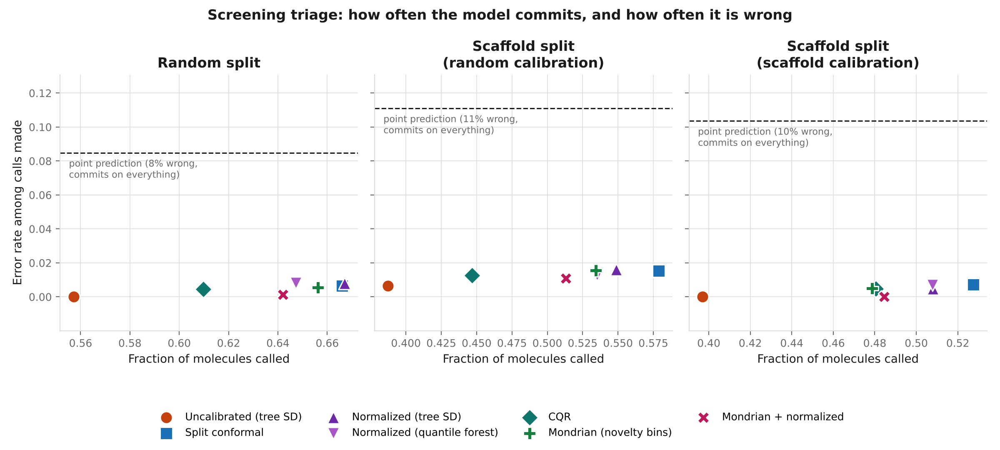

# Reliable AI for Drug Candidate Screening — conformal LogS prediction

Implementation of the DS 340W project described in the midterm paper:
a reproducible evaluation of **conformal prediction** for molecular property
prediction, using a Random Forest on RDKit descriptors to predict aqueous
solubility (LogS) and asking whether its 90% prediction intervals can be
trusted — especially for molecules unlike anything in the training set.

The rest of this repository is the forked [V-SYNTHES2](../README.md) virtual
screening pipeline (parent paper 1), which motivates the problem: screening at
scale only pays off if the predictions it produces can be trusted.

**Where the project stands.** H1–H3 of the midterm paper are answered below,
and the answer to H3 is the uncomfortable one: marginal coverage is not
conditional coverage. Split conformal hits its 90% target on average while
covering the least-familiar quarter of the test set only 0.82–0.84 of the
time. Since the unfamiliar molecules are the entire point of a screening
campaign, an average that hides them is not a reliability guarantee worth
having. H4 and H5 follow from that: H4 asks whether calibrating *within*
novelty groups fixes it, and H5 asks what any of it is worth to a screen that
has to accept or reject candidates under a budget.

---

## Quickstart

```bash
python3 -m venv .venv && source .venv/bin/activate
pip install -r conformal_logS/requirements.txt
```

Both datasets are committed under `data/raw/`, so nothing needs downloading.
(ESOL came from DeepChem's S3 mirror; AqSolDB's canonical host, Harvard
Dataverse `doi:10.7910/DVN/OVHAW8`, is unreachable from some networks, and a
dataset you cannot fetch is a result nobody can reproduce.)

```bash
cd conformal_logS && python scripts/run_experiment.py
```

```bash
cd conformal_logS && python scripts/run_experiment.py --dataset aqsoldb --results-dir results_aqsoldb
```

The ESOL sweep (3 split regimes × 7 interval methods × 5 seeds) takes about
five minutes on a laptop; AqSolDB, nine times the data, takes about half an
hour. `--quick` runs one seed with 100 trees. Tables land in `results/`,
figures in `results/figures/`, and the H1–H5 verdicts print as a markdown
table.

```bash
cd conformal_logS && python -m pytest tests -q      # 92 tests
```

> **RDKit must be older than 2026.03.** Release 2026.09 ships a broken Murcko
> decomposition (`bad any cast`) that makes every scaffold split fail;
> `requirements.txt` pins below it, and `splits.py` raises a readable error if
> you end up on a bad version anyway.

---

## What the pipeline does

```
SMILES + measured LogS      ESOL 1,117 · AqSolDB 9,574 molecules after curation
        │
        ├─ RDKit descriptors (216)  ─────────►  Random Forest (500 trees)
        │                                            │        │
        │                                            │        └─ quantile read-out
        └─ Morgan fingerprints  ──► Tanimoto         │              (CQR, QRF scale)
           (novelty bins, H3 + Mondrian)             ▼
                                        calibration set → 90% interval
                                                     │
                                                     ▼
                      MAE · RMSE · PICP · MPIW · coverage gap · interval score
                      per-quartile coverage · accept/reject/defer triage
```

**Data.** Two datasets behind one interface, so every result can be checked
for whether it survives a change of dataset.

| | ESOL (Delaney) | AqSolDB |
|---|---:|---:|
| Raw rows | 1,128 | 9,982 |
| After curation | 1,117 | 9,574 |
| Unparseable dropped | 0 | 2 |
| Duplicate structures collapsed | 11 | 406 |

Curation canonicalizes every SMILES, drops unparseable rows, keeps the
largest organic fragment of a salt or mixture, and collapses duplicate
structures to the median of their measurements. Without that last step a
molecule could appear on both sides of a split and quietly inflate coverage —
and AqSolDB needs it far more than ESOL does, being an aggregation of nine
source databases.

AqSolDB is not decoration. ESOL's scaffold-split PICP carries a seed-to-seed
standard deviation of up to 0.11, because its scaffold-disjoint test set is a
handful of scaffold groups; the same number on AqSolDB is 0.04. Several
conclusions below hold on both, and one — how badly scaffold splitting breaks
split conformal — turns out to be substantially an artefact of ESOL's size.

**Features.** All RDKit descriptors except `Ipc`, which overflows on
medium-sized rings. Non-finite values become NaN and are imputed with the
*training* median inside the sklearn pipeline, so nothing leaks from the test
set into the model.

**Three split regimes**, which is the heart of the experiment:

| Regime | Test set | Calibration set |
|---|---|---|
| `random` | random molecules | random molecules |
| `scaffold` | scaffold-disjoint | **random** slice of the remaining data |
| `scaffold_ood_calib` | scaffold-disjoint | **its own** scaffold block |

The third regime is an addition to the proposal, and it earns its place: under
`scaffold`, the calibration data is exchangeable with the *training* data but
not with the *test* data, so conformal prediction's guarantee does not apply.
Comparing the two scaffold regimes separates "the model is worse out of
distribution" from "the calibration set came from the wrong distribution" —
two explanations for the same lost coverage, with very different fixes.

**Seven interval methods**, all wrapped around the same fitted forest, so any
difference in coverage comes from calibration alone. That constraint is what
makes the comparison mean anything, and it is why the quantile methods read
their quantiles *out of* the existing forest rather than training a second
one — the reported point prediction is the same number in every row.

| Method | Width is | Adapts to |
|---|---|---|
| `uncalibrated_gaussian` | ±1.645 × tree spread | nothing (uncalibrated) |
| `split_conformal` | one constant | nothing |
| `normalized_conformal` | constant × tree spread | per molecule |
| `normalized_conformal_qrf` | constant × forest IQR | per molecule |
| `cqr` | the forest's own quantiles, padded | per molecule, asymmetrically |
| `mondrian_conformal` | one constant **per novelty bin** | structural novelty |
| `mondrian_normalized` | per-bin constant × tree spread | both |

- `uncalibrated_gaussian` — the common practice the project argues against: it
  assumes Gaussian errors and a calibrated ensemble spread, and guarantees
  nothing.
- `split_conformal` — one width for every molecule, set to the
  ⌈(n+1)(1−α)⌉-th smallest absolute residual on a held-out calibration set.
  The finite-sample rank is taken directly on the sorted scores, not through
  `np.quantile`, whose interpolation would erode the guarantee.
- `normalized_conformal` — the same guarantee, but the non-conformity score is
  divided by a per-molecule difficulty estimate (the tree spread), so hard
  molecules get wider intervals than easy ones.
- `normalized_conformal_qrf` — the same again, with the forest's conditional
  inter-quantile range in place of tree spread. Tree spread is *epistemic*: it
  measures disagreement between trees about the mean, and collapses toward
  zero on molecules the trees agree about even when the measurement itself is
  noisy. The inter-quantile range carries the irreducible noise too.
- `cqr` — conformalized quantile regression (Romano et al., 2019), cited in
  the midterm paper and now implemented. The forest's conditional quantiles at
  α/2 and 1−α/2 give a provisional interval; one calibrated quantile of
  `max(q_lo − y, y − q_hi)` pads or trims it. The interval need not be
  symmetric about the point prediction, so a skewed conditional distribution
  is represented honestly.
- `mondrian_conformal` — **the method H4 is about.** Split conformal's
  guarantee is marginal: 90% of the test set on average. Mondrian
  (group-conditional) conformal prediction fixes a partition in advance and
  calibrates each cell separately, so the guarantee holds *within* each group.
  Here the partition is structural novelty. Bin edges are fixed on the
  calibration molecules and applied to new molecules from their features
  alone, so no test label is ever consulted; a molecule less familiar than
  anything in calibration falls into bin 0 and gets the widest width, which is
  the conservative direction. A bin with too few calibration molecules to
  certify a width borrows the pooled one and records that it did, in
  `results/mondrian_diagnostics.csv`.
- `mondrian_normalized` — both mechanisms at once.

**Structural novelty (H3).** For each test molecule, the maximum Tanimoto
similarity to any *training* molecule, on Morgan fingerprints. Maximum, not
mean: what matters is whether the model has seen anything like this compound.
Test molecules are then grouped into equal-count quartiles, Q1 being least
familiar.

These evaluation quartiles are computed on the test set and are deliberately
*not* the bins Mondrian calibrates within — scoring a method on its own
partition would flatter it. Every method is judged on the same fixed
partition.

---

## Results

Mean over 5 seeds, 90% target intervals. Full tables in `results/` (ESOL) and
`results_aqsoldb/` (AqSolDB). Every number below is reproduced by the two
commands in the Quickstart.

### Headline — ESOL, 1,117 molecules

| Split | Method | MAE | RMSE | PICP | MPIW | Coverage gap | Interval score |
|:---|:---|---:|---:|---:|---:|---:|---:|
| random | uncalibrated | 0.475 | 0.653 | 0.962 | 2.693 | +0.062 | 2.957 |
| random | **split conformal** | 0.475 | 0.653 | **0.899** | 2.085 | **−0.001** | 3.009 |
| random | normalized (tree SD) | 0.475 | 0.653 | 0.906 | 1.983 | +0.006 | 2.718 |
| random | normalized (QRF) | 0.475 | 0.653 | 0.910 | 2.079 | +0.010 | **2.697** |
| random | CQR | 0.475 | 0.653 | 0.904 | 2.340 | +0.004 | 2.909 |
| random | Mondrian | 0.475 | 0.653 | 0.923 | 2.207 | +0.023 | 2.989 |
| random | Mondrian + norm. | 0.475 | 0.653 | 0.915 | 2.146 | +0.015 | 2.747 |
| scaffold | uncalibrated | 0.712 | 0.930 | 0.905 | 3.204 | +0.005 | 4.221 |
| scaffold | split conformal | 0.712 | 0.930 | 0.739 | 1.944 | −0.161 | 5.089 |
| scaffold | normalized (tree SD) | 0.712 | 0.930 | 0.774 | 2.228 | −0.126 | 4.613 |
| scaffold | normalized (QRF) | 0.712 | 0.930 | 0.789 | 2.273 | −0.111 | 4.482 |
| scaffold | **CQR** | 0.712 | 0.930 | **0.855** | 2.943 | **−0.045** | **4.477** |
| scaffold | Mondrian | 0.712 | 0.930 | 0.789 | 2.271 | −0.111 | 4.802 |
| scaffold | Mondrian + norm. | 0.712 | 0.930 | 0.822 | 2.517 | −0.078 | 4.507 |
| scaffold (OOD calib.) | split conformal | 0.742 | 0.957 | 0.831 | 2.579 | −0.069 | 4.513 |
| scaffold (OOD calib.) | **Mondrian + norm.** | 0.742 | 0.957 | **0.854** | 2.786 | **−0.046** | **4.245** |

### Headline — AqSolDB, 9,574 molecules

| Split | Method | MAE | RMSE | PICP | PICP sd | MPIW | Coverage gap |
|:---|:---|---:|---:|---:|---:|---:|---:|
| random | uncalibrated | 0.695 | 1.020 | 0.949 | 0.008 | 3.559 | +0.049 |
| random | split conformal | 0.695 | 1.020 | 0.905 | 0.010 | 3.214 | +0.005 |
| random | **normalized (tree SD)** | 0.695 | 1.020 | 0.905 | 0.010 | **2.879** | +0.005 |
| random | Mondrian + norm. | 0.695 | 1.020 | 0.904 | 0.008 | 2.898 | +0.004 |
| scaffold | uncalibrated | 0.779 | 1.063 | 0.954 | 0.010 | 4.074 | +0.054 |
| scaffold | split conformal | 0.779 | 1.063 | 0.876 | 0.040 | 3.110 | −0.024 |
| scaffold | **Mondrian + norm.** | 0.779 | 1.063 | **0.907** | 0.018 | 3.327 | **+0.007** |
| scaffold (OOD calib.) | split conformal | 0.784 | 1.062 | 0.881 | 0.050 | 3.176 | −0.019 |
| scaffold (OOD calib.) | Mondrian + norm. | 0.784 | 1.062 | 0.885 | 0.037 | 3.133 | −0.015 |


### H1 — conformal calibration beats the uncalibrated baseline

**Supported under random splitting. Under scaffold splitting it depends on
the method, and on ESOL it fails outright for split conformal.**

On random splits the result is clean and holds on both datasets: split
conformal lands on 0.899 (ESOL) and 0.905 (AqSolDB) against a 0.900 target,
while the uncalibrated baseline over-covers at 0.962 / 0.949 and buys that
coverage with intervals 29% / 11% wider.

Under scaffold splitting on ESOL, split conformal drops to 0.739 and H1
fails: the uncalibrated baseline *appears* to win at 0.905, but it is not
calibrated, it is simply wide (MPIW 3.20), and it stays wide whether or not
the width is needed. The interval score, which penalises width and misses
together, still rates the baseline better (4.22 vs 5.09).

This is not a bug in the conformal implementation; it is the exchangeability
assumption failing, which a scaffold split is designed to cause.

**But the size of that failure is largely an ESOL artefact.** The same
experiment on AqSolDB puts split conformal at 0.876 under scaffold splitting,
not 0.739, and the seed-to-seed spread falls from 0.113 to 0.040. ESOL's
scaffold-disjoint test set is a handful of scaffold groups, so "the test set
is unfamiliar" and "the test set is small and peculiar" are confounded in it.
A reader of the midterm paper should take the qualitative claim — scaffold
shift costs coverage — and not the magnitude.

### H1\* — calibrating on unfamiliar molecules recovers most of the loss

Keeping the ESOL test set fixed and changing only where calibration molecules
come from:

| Method | Random calibration | Scaffold calibration |
|:---|---:|---:|
| split conformal | 0.739 (gap −0.161) | **0.831** (gap −0.069) |
| normalized conformal | 0.774 (gap −0.126) | **0.840** (gap −0.060) |

Two-thirds of the lost coverage comes back. The practical lesson for a
screening campaign is concrete: **calibrate on molecules as unfamiliar as the
ones you intend to predict**, not on a convenient random slice of the
training library.

### H2 — scaffold splitting costs accuracy

**Supported on both datasets.** ESOL: RMSE rises from 0.653 to 0.930 and MAE
from 0.475 to 0.712, roughly a 45% increase, consistent across all five
seeds. AqSolDB: RMSE 1.020 → 1.063 and MAE 0.695 → 0.779, a much smaller
penalty — with nine times the scaffold diversity, a scaffold-disjoint test
set is less of an extrapolation.


### H3 — reliability degrades for structurally unfamiliar molecules

**Supported for every marginally-calibrated method, on both datasets.**
Coverage falls as test molecules get less similar to the training set:

| Dataset | Split | Method | Q1 (least familiar) | Q4 (most familiar) | Q4 − Q1 |
|:---|:---|:---|---:|---:|---:|
| ESOL | random | split conformal | 0.815 | 0.956 | 0.140 |
| ESOL | random | normalized (tree SD) | 0.858 | 0.941 | 0.083 |
| ESOL | scaffold | split conformal | 0.697 | 0.807 | 0.110 |
| AqSolDB | random | split conformal | 0.835 | 0.943 | 0.108 |
| AqSolDB | scaffold | split conformal | 0.845 | 0.908 | 0.064 |

Note what this means even in the friendly case: on a *random* split, where
marginal coverage is a near-perfect 0.899, the least familiar quartile is
covered only 0.815 of the time. Marginal validity is an average over the whole
test set, and it hides exactly the molecules a screening campaign cares about.


### H4 — calibrating within novelty bins evens coverage out

**Supported.** This is the hypothesis the new methods were built for, and the
clean way to read it is the Q4 − Q1 spread from H3: zero means reliability no
longer depends on familiarity.

| Dataset | Split | Method | Worst-quartile gap | Q4 − Q1 |
|:---|:---|:---|---:|---:|
| ESOL | random | split conformal | 0.099 | 0.140 |
| ESOL | random | Mondrian | 0.062 | 0.022 |
| ESOL | random | **Mondrian + norm.** | 0.068 | **0.003** |
| ESOL | random | CQR | **0.062** | 0.021 |
| ESOL | scaffold | split conformal | 0.263 | 0.110 |
| ESOL | scaffold | Mondrian + norm. | 0.169 | −0.032 |
| ESOL | scaffold | **CQR** | **0.127** | 0.051 |
| AqSolDB | random | split conformal | 0.065 | 0.108 |
| AqSolDB | random | **Mondrian + norm.** | **0.026** | 0.013 |
| AqSolDB | scaffold | split conformal | 0.068 | 0.064 |
| AqSolDB | scaffold | **Mondrian + norm.** | **0.030** | −0.018 |

On a random split, Mondrian + normalized reduces the ESOL novelty spread from
0.140 to 0.003 — coverage becomes essentially independent of how familiar the
molecule is — while the worst quartile's distance from the target drops from
0.099 to 0.068. On AqSolDB the worst-quartile gap falls by more than half,
0.065 → 0.026, and the same holds under scaffold splitting, 0.068 → 0.030.



Three things are worth saying plainly about this result.

**Mondrian can over-correct.** Under scaffold splitting the Q4 − Q1 spread
goes *negative* (−0.032 on ESOL, −0.018 on AqSolDB): the unfamiliar molecules
end up better covered than the familiar ones. H3's directional claim simply
stops being true once calibration is conditional — which is the point, but it
means "H3 holds" is a statement about marginally-calibrated methods, not a
law about molecules.

**Mondrian needs unfamiliar molecules in the calibration set.** Under the
plain `scaffold` regime the calibration set is a random slice of the training
pool, so every bin — including bin 0 — is calibrated on familiar molecules,
and no partition of them can describe an unfamiliar one. That is why Mondrian
improves ESOL's scaffold worst-quartile gap only from 0.263 to 0.232 on its
own, and why pairing it with normalization (0.169) does better. The method
can only sharpen information the calibration set actually contains.

**CQR is the surprise.** It was added as a faithful implementation of a paper
the midterm cited, not as a contender, and under ESOL scaffold shift it beats
everything: PICP 0.855 against split conformal's 0.739, worst-quartile gap
0.127 against 0.263. Its widths come from the forest's own conditional
quantiles, which widen where the forest's leaves disagree — and out-of-domain
molecules land in leaves that pool dissimilar training compounds. It is doing
something structurally different from scaling one number, and on the hardest
condition tested it wins.

A matching caveat: CQR cannot see difficulty the forest had no reason to
split on. A quantile forest reads its distribution out of a partition built
to predict the *mean*, so difficulty that does not shift the mean is
invisible to it. `tests/test_mondrian_and_cqr.py` demonstrates this on data
where the noisy and quiet groups have the same mean: CQR gives them widths
within 1.3× of each other while Mondrian separates them by more than 2×.
Structural novelty is of that kind — it does not change a molecule's
solubility, it changes how wrong the model is about it — which is why the two
methods are complementary rather than redundant.

### H5 — calibrated intervals make better screening decisions

**Supported, by roughly an order of magnitude.** Coverage and width are the
right diagnostics but not the reason anyone wants uncertainty. V-SYNTHES2
does not ask "what is this molecule's LogS"; it asks "is this molecule worth
the next stage". So fix a threshold (LogS ≥ −4) and let the interval make a
three-way call: **accept** if it lies entirely above, **reject** if entirely
below, **defer** if it straddles. A point prediction has no third option.

| Dataset | Split | Method | Molecules called | Error among calls | Point-call error |
|:---|:---|:---|---:|---:|---:|
| ESOL | random | split conformal | 67% | 0.7% | 8.5% |
| ESOL | random | **Mondrian + norm.** | 64% | **0.1%** | 8.5% |
| ESOL | scaffold | split conformal | 58% | 1.5% | 11.1% |
| ESOL | scaffold | Mondrian + norm. | 51% | 1.1% | 11.1% |
| AqSolDB | random | normalized (tree SD) | 59% | 0.8% | 9.6% |
| AqSolDB | scaffold | split conformal | 49% | 2.3% | 13.1% |
| AqSolDB | scaffold | **Mondrian + norm.** | 47% | **1.2%** | 13.1% |

A screen that ignores uncertainty gets 8.5–13.1% of its accept/reject calls
wrong, and has no way of knowing which. The same model, reporting calibrated
intervals, is wrong on 0.1–2.3% of the calls it makes — and declines to call
the remaining third to half, which in a real campaign is the queue that goes
to an assay instead of straight to synthesis.



This framing is also what exposes the uncalibrated baseline. On ESOL random
splits it has the lowest error rate of all (0.0%) — because it commits on
only 56% of molecules, the least of any method. Judged on coverage it looked
conservative; judged on decisions it is simply doing less work. Reporting
both axes is what makes the difference visible.

### Connecting back to V-SYNTHES2

`scripts/conformal_docking.py` applies the same machinery to the parent
pipeline's own decision. V-SYNTHES2 is hierarchical: it docks a MEL fragment,
keeps the fragments that score well, enumerates those into full molecules,
and re-docks. The expensive step is the re-docking, and the choice of which
fragments to carry into it is made on the *fragment's* score, before anyone
knows what the enumerated molecule will score. Its output files carry both
numbers — `orig_Score` and `Score` — so the gap is measurable, and it is
exactly what a calibrated interval can bound.

On `RMSD_assessment/list_1.sdf`, the ten-molecule example shipped with this
repository, the fragment score and the final score agree in rank at Spearman
0.146, and the gap between them ranges from +8.5 to +15.3 score units. Ten
molecules is far too few to conclude anything, and it is also too few to
calibrate on: split conformal needs at least ⌈1/α⌉ − 1 = 9 calibration
molecules before a 90% interval exists at all, so the script reports what it
needs rather than returning a confident-looking number. Running it for real
needs a V-SYNTHES2 run over a REAL-space subset from a licensed ICM-Pro+VLS
installation, as the main README's Procedure 1 describes.

The module names and excludes every pose-derived SDF field — the score, its
component terms, the rescoring values — because none of them exist at the
moment the decision is made, and a model fed them would look excellent and
mean nothing.

### Summary

- Conformal prediction delivers what it promises **when its assumption
  holds**, with tighter intervals than an uncalibrated ensemble.
- A scaffold split breaks that assumption and costs coverage. How much is
  dataset-dependent: 0.74 on ESOL, 0.88 on AqSolDB.
- Most of that loss is a *calibration-set* problem, not a model problem:
  matching the calibration distribution to the deployment distribution
  recovers it to ~0.85.
- **Marginal coverage is not conditional coverage**, and the gap falls on
  exactly the molecules screening cares about.
- **Calibrating within novelty bins closes most of that gap** — the ESOL
  random-split spread between the least- and most-familiar quartiles goes
  from 0.140 to 0.003 — and CQR closes it best under the hardest shift.
- Used for screening decisions, calibrated intervals cut confident errors
  from 8.5–13.1% to 0.1–2.3%, at the cost of deferring a third to a half of
  the library.

---

## Repository layout

```
conformal_logS/
├── README.md
├── requirements.txt
├── data/
│   ├── raw/delaney-processed.csv          ESOL, committed, not modified
│   ├── raw/curated-solubility-dataset.csv AqSolDB, committed, not modified
│   └── processed/*_curated.csv            written by the pipeline
├── results/                 ESOL tables, figures, config + environment record
├── results_aqsoldb/         the same for AqSolDB
├── scripts/
│   ├── run_experiment.py    the main sweep
│   └── conformal_docking.py calibrated intervals for V-SYNTHES2 hit expansion
├── src/conformal_solubility/
│   ├── config.py          every tunable in one dataclass, saved with the results
│   ├── data.py            dataset registry; load, canonicalize, de-duplicate
│   ├── features.py        RDKit descriptors + Morgan fingerprints
│   ├── splits.py          random / scaffold / scaffold-OOD-calibration splits
│   ├── conformal.py       the forest and the seven interval methods
│   ├── quantile_forest.py quantile regression forest read off the fitted forest
│   ├── metrics.py         MAE, RMSE, PICP, MPIW, coverage gap, interval score
│   ├── novelty.py         Tanimoto novelty, quartiles, and Mondrian bin edges
│   ├── screening.py       accept / reject / defer triage against a threshold
│   ├── vsynthes.py        the bridge back to V-SYNTHES2 docking output
│   ├── experiment.py      the sweep, aggregation, and H1–H5 verdicts
│   └── plots.py           the six figures
└── tests/                 92 tests
```

### Result files

| File | What it holds |
|---|---|
| `summary.csv` | marginal metrics per split × method, mean and sd over seeds |
| `conditional_summary.csv` | per-novelty-quartile coverage summaries (H4) |
| `screening_summary.csv` | accept/reject/defer outcomes (H5) |
| `novelty_summary.csv` | the per-quartile table behind H3 |
| `mondrian_diagnostics.csv` | bin edges, per-bin widths, and any pooled fallbacks |
| `hypothesis_verdicts.csv` | every H1–H5 comparison with its numbers |
| `test_predictions.csv.gz` | per-molecule predictions, intervals and novelty |
| `config.json`, `environment.json`, `curation_counts.json` | the run's record |

## Reproducibility

Every run writes `config.json` (all settings), `environment.json` (package
versions), and `curation_counts.json` (what curation dropped), alongside the
per-seed metrics. Splits and forests are seeded; re-running the commands in
the Quickstart reproduces the numbers above.

Both raw datasets are committed, so a run needs no network access.

The test suite checks the parts that would fail silently:

- split conformal attains nominal coverage on synthetic data, and the
  finite-sample quantile uses the right rank;
- Mondrian attains coverage **within each group** on data built so that one
  pooled width must fail, and the pooled comparison does fail there;
- the vectorised quantile-forest read-out matches a direct transcription of
  Meinshausen's weighting formula, exactly, element for element;
- the quantile read-out does not disturb the fitted model's predictions;
- no scaffold leaks across a split, and no pose-derived field reaches the
  docking model;
- the screening metrics match hand-computed decisions, and report `NaN`
  rather than a flattering zero when a method commits to nothing.

## Limitations and next steps

- **Two datasets, one property.** Both are aqueous solubility. Whether these
  conclusions transfer to permeability or toxicity endpoints — where the
  measurement noise is larger and more structured — is untested. The parent
  conformal-ADMET paper benchmarks eight endpoints; this benchmarks one.
- **Descriptors, not a learned representation.** The parent paper uses a graph
  neural network; the RMSE here (0.65 random / 0.93 scaffold on ESOL) is in
  the expected range for a descriptor-based Random Forest but is not
  competitive with a GNN. Nothing in H4 or H5 depends on the base model, so
  swapping it is the cleanest way to test how much of this is forest-specific.
- **Mondrian bins are fixed and one-dimensional.** Four equal-count bins on a
  single novelty axis. Binning on difficulty *and* novelty jointly, or
  choosing the number of bins by a criterion rather than by hand, is the
  obvious refinement — and the fallback machinery for thin bins already
  exists to support finer partitions.
- **Novelty is Tanimoto on Morgan fingerprints.** A reasonable and standard
  choice, but it is one definition of "unfamiliar" among several; a
  descriptor-space distance or a model-internal measure might bin better.
- **The V-SYNTHES2 bridge is untested on real data.** The machinery is built
  and its leakage guards are tested, but the example SDFs in this repository
  hold ten molecules. It needs one real V-SYNTHES2 run to become a result.
- **The screening threshold is a choice.** LogS ≥ −4 is a common
  "poorly soluble" boundary, and `screening_curve` sweeps several thresholds,
  but the headline H5 numbers are reported at one of them.
